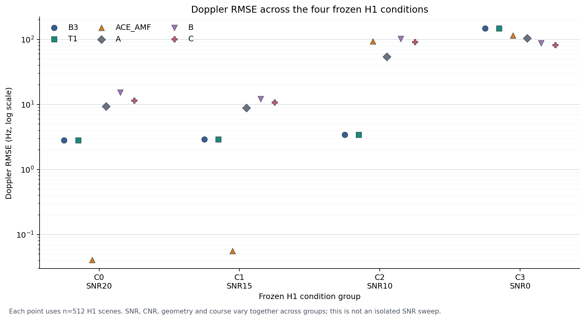

# D2-A-R4 阶段分析：相位增强只在 C0 子集上看似满足物理一致性

**实验性质：** 合成数据探索性诊断；不构成盲测或 T001 冻结门重判。

**总纲：** `docs/RESEARCH_CHARTER.md` v1.2，提交 `289b812e8bc93fbdabca0cfb3722ad24f045351b`；本文未修改总纲。

**主要运行版本：** 诊断结果记录于 `6038d83d9464ea476ba873596fe430a9bdf6b6fd`；pilot 训练及评价记录于 `971dd3704053ebfa462388d4cf34cb3e60efcc48`；分层敏感性复核运行于 `66c9631f6102ff7477ff600b0263685782be5211`。
**数据：** 4096 H0 校准、4096 独立 H0 验证、2048 配对 H1 开发场景；均为新种子。另有一个 seed 101、1600 update 的 CUDA E1 truth-only pilot。没有 KD、正式三种子或 final blind。

## 结论摘要

- 复尺度不变性审计须区分数学变换和复数精度造成的输入量化。先提升到 complex128 再缩放、之后转换后端输入时，R4 的 `1e-5` 新诊断门通过；历史 T001 的 `4.58e-5` 对其冻结 `1e-6` 门仍失败。`1e-4` 不是合适的通用容差：complex64 先量化再乘复数因子产生 `2.44e-4` 最大分数差，CPU/CUDA 分数最大绝对差 `3.09e-4`；后者相对差只有 `9.30e-7`，且没有峰位置或阈值判决改变。
- 在 R4 的 H0 mixture 中，B3 按潜在参考幅度分位分组的 Pfa 为 0–0.119；T1 为 0.046–0.052。结合生成器按 A、SNR、CNR 设置噪声和杂波功率，这与 B3 的幅度尺度敏感相符；该分层是场景统计关系，不是 R4 对 B3 做的单场景 `X,aX` 受控干预。T1 的表现支持其对该分层更稳健，但 C3 Pfa 仍为 0.178–0.217。
- T1 的检测表现优于 B3 与 ACE×AMF 的总体结果，但其频率/距离峰与 B3 完全相同；增益来自检测分数归一化和阈值行为，不是更好的参数定位。ACE×AMF 在分离 C0/C1 的估计很好，在部分重叠 C2/C3 明显失效。
- 首轮相位与频移诊断的前 256 个 H1 样本全属 C0。原结果保留。固定随机种子重抽 64 个样本/组后，冻结学生 A/B/C 的公共相位判决一致率为 0.916/0.925/0.916；pilot 的冻结 S0 与增强 S1 为 0.905/0.909，Doppler 输出变化 p95 为 78.8/63.1 Hz。S1 的相位增强没有在跨条件诊断中获得足够不变性。
- 同一批 2048 个独立 H1 的配对 bootstrap 显示 S1 相对 S0 的 Doppler RMSE 改善 6.29 Hz（95% CI `[-9.16,-2.84]`），但 Pd 下降 1.17 个百分点、joint success 下降 3.13 个百分点；range RMSE 差异区间跨零。该 single-seed 探索结果不足以支持继续训练或开始蒸馏。
- **阶段建议：REFINE。** 保留 T001、R3、E002 的冻结结论；停止以当前 TaskStudent 的单一公共相位增强作为解决方案。下一步先进行独立研究方向审查，再决定是否预注册一个最小物理表示诊断。不得启动正式三种子、KD 或 blind。

## 与研究总纲的关系

本阶段服务于总纲的任务级 GMTI 学生目标：检查直接从三通道复数 IQ 学习检测和参数估计时，复数尺度、相干信息及公共相位关系是否构成瓶颈；同时检验传统教师的输出能否支持后续学生训练。R4 不是独立 CFAR 研究。T1/ACE 的诊断只评价教师可靠性，最终优先级仍由学生的检测、参数和联合任务决定。

## 协议与实现范围

沿用 D2-A-E001 的三通道、PRF 1300 Hz、130 脉冲、32 距离单元、静止杂波和复 AWGN 条件。冻结比较 B3、T1 和 ACE×AMF；学生只读取 observable IQ，使用 E002 seed 101 的 A/B/C checkpoint 和原校准阈值。教师使用 R4 新 H0 calibration 阈值。复尺度变换在 complex128 中形成，再按后端精度输入。教师评分、学生训练和评价均使用 RTX 3050 Laptop `cuda:0`；CPU 只作为数值参考。

H0 生成器按潜在参考目标幅度 `A` 设置噪声：

```text
noise_power = A² × 10^(-SNR/10)
clutter_power = noise_power × 10^(CNR/10)
```

同一随机种子换成四种目标场景标签时，H0 IQ 逐元素完全相同，噪声功率相等；检测器没有读场景标签。因此没有证据表明 H0 生成存在目标标签分支泄漏。A 对 H0 的噪声/杂波总体尺度有影响，是当前仿真机制的一部分；它不是仿真器把 H1 标签写入 H0。实现位置见 [d2a.py](../../src/radardistill/simulation/d2a.py#L444) 和 [R4 runner](../../scripts/run_d2a_r4.py#L1284)。

## 数值精度与 `1e-4` 是否可接受

| 比较 | 最大绝对 score 差 | 最大相对 score 差 | 峰位置变化 | 阈值判决变化 | 结论 |
|---|---:|---:|---:|---:|---|
| complex128 正确构造后送 CPU complex128 与 CUDA complex64；复因子 `0.6+1.2j` | CPU `1.08e-12`；CUDA `0` | CPU `4.40e-15`；CUDA `0` | 0/64 | 0/64 | 三个复尺度在 R4 新 `1e-5` score/map/soft-map 门下通过 |
| legacy：先转 complex64，再乘 `0.6+1.2j` | `2.4414e-4` | `4.10e-7` | 0/64 | 0/64 | 因输入量化超过 `1e-5`；同样超过 `1e-4` |
| ACE×AMF CPU reference 与 CUDA complex64 | `3.0946e-4` | `9.30e-7` | 0/64 | 0/64 | 绝对差超过 `1e-4`，但相对差极小且决策一致 |

因此不能把所有运算统一放宽到 `1e-4`：它既不能接受实际 `complex64` legacy 路径，也不能覆盖 CPU/CUDA 的最大绝对差。`1e-5` 保留为 R4 数学尺度不变性诊断门；跨后端实现一致性需结合归一化误差、峰位置和阈值决定评价。**1e-4 只有在明确是某个应用分数的误差预算、且其相对量级和决策后果预先合理时才可能接受；本实验没有证据支持将它作为统一精度标准。** T001 原始 G1 数值 `4.5776e-5 > 1e-6` 和 FAIL 冻结，不因 R4 复核而改判。

## H0 阈值与幅度 nuisance

教师和冻结学生的总体指标如下。Pfa 区间为单侧 exact 95% 上限；阈值均按各自协议来源固定。

| 方法 | H0 Pfa | exact 上限 | Pd | AUC | joint success | Range RMSE (cell) | Doppler RMSE (Hz) |
|---|---:|---:|---:|---:|---:|---:|---:|
| B3 | 0.0466 | 0.0524 | 0.4810 | 0.9194 | 0.3901 | 5.912 | 74.167 |
| T1 | 0.0493 | 0.0552 | 0.7500 | 0.9598 | 0.7129 | 5.912 | 74.167 |
| ACE×AMF | 0.0520 | 0.0581 | 0.5767 | 0.8779 | 0.5288 | 7.970 | 74.231 |
| 冻结学生 A | 0.0488 | 0.0547 | 0.7524 | 0.9544 | 0.5376 | 5.402 | 58.952 |
| 冻结学生 B | 0.0464 | 0.0522 | 0.7485 | 0.9455 | 0.4878 | 5.392 | 68.086 |
| 冻结学生 C | 0.0479 | 0.0537 | 0.7397 | 0.9517 | 0.5146 | 5.617 | 61.716 |

R4 总体混合 H0 上的 Pfa 接近 0.05，不能掩盖分层失败。C3/SNR=0 dB 和 C3/SNR=10 dB 的 Pfa 分别为：B3 `0.373/0.000`、T1 `0.217/0.178`、ACE×AMF `0.125/0.111`；冻结学生 A `0.195/0.168`、B `0.152/0.186`、C `0.178/0.193`。样本量分别为 512，区间见 [metrics.json](metrics.json) 与 [result.csv](result.csv)。当前没有方法在 C3 条件下稳定达到其总体阈值目标。

按潜在参考幅度四分位分层时，B3 Pfa 为 `0/0.0029/0.0645/0.1191`；T1 为 `0.0508/0.0488/0.0459/0.0518`；ACE×AMF 为 `0.0576/0.0557/0.0459/0.0488`。学生 A/B/C 在这些幅度组的 Pfa 范围分别为 `0.037–0.058`、`0.036–0.057`、`0.037–0.059`。该切片显示 B3 分数对生成尺度组更敏感、T1和学生分数的 Pfa 在组间更接近；由于分位分组仍来自 mixture，不把它解释成单独的受控缩放因果效应。C3 条件高虚警表明更细的噪声/杂波场景差异仍未处理。四分位是诊断切片，不是新阈值校准组。

## 教师与学生的参数表现



每个 H1 组 512 个场景。四组的 SNR、CNR、几何和航迹条件同时变化，故图是条件对比，不是单变量 RMSE–SNR 曲线。逐项数字见 [result.csv](result.csv)。

- T1 的 R4 峰值位置图与 B3 相同：总体正确位置率均为 0.7559，整体 range/Doppler RMSE 也相同。T1 在可辨识 C2 的 Pd/joint success 为 0.8418/0.8418，而 B3 为 0/0，体现了全局鲁棒背景归一化对分数阈值的作用。C3 中 T1 的 AUC 约 0.495、joint success 约 0.0098，仍不能稳定检测和定位困难目标。
- ACE×AMF 在 C0/C1 的 Doppler RMSE 约 `0.041/0.056 Hz`，但 C2/C3 分别升至 `93.6/115.2 Hz`，joint success 降至 `0.113/0.002`。它不是当前全部可辨识场景可用的教师。
- 冻结学生 A/B/C 的 pooled Doppler RMSE 分别是 `58.95/68.09/61.72 Hz`。它们在 C0/C1 约 9–15 Hz，在 C2/C3 约 54–104 Hz。A 在这组三个冻结学生中 pooled RMSE 最低，但 C3 的检测和参数误差仍差。
- 这些汇总值受四组不同难度和标签分布影响，不能作为独立 SNR 因果效应，也不能宣称网络超过传统估计器；本实验未设与每个学生完全匹配的纯物理参数估计对照。

## 公共相位与目标频移：取样敏感性复核

原始实现按 H1 数组顺序取前 256 行。由于 `generate_h1_cells` 先写入 C0 的 512 行，原始 phase/shift 诊断只抽到 C0；结果已保留在 `metrics.json` 和 `pilot.json`，没有覆盖。新增的后验敏感性分析使用种子 `2026102804`，从四个固定 H1 组各无放回抽取 64 个，单独输出到 [sampling_sensitivity.json](sampling_sensitivity.json)。它不改变原协议和阶段门。

| 模型 | 原首 256 的 phase agreement | 平衡抽样 agreement | 平衡抽样 Doppler change p95 |
|---|---:|---:|---:|
| 冻结学生 A | 1.000 | 0.923 | 85.49 Hz |
| 冻结学生 B | 1.000 | 0.925 | 73.50 Hz |
| 冻结学生 C | 1.000 | 0.916 | 64.04 Hz |
| Pilot S0 | 1.000 | 0.905 | 78.77 Hz |
| Pilot S1 | 1.000 | 0.909 | 63.13 Hz |

原始值只适用于 C0，不能支撑跨条件相位不变性结论。平衡子集说明四组混合诊断明显不通过 0.99 一致率要求；但每组只有 64 个场景，属于 post-hoc 敏感性证据，不替代新冻结独立验证。目标分量人工频移是受控反事实，不等于重生成真实运动；具体残差分布按“基线峰值位置正确/错误”分层保存在 JSON。

## S1 pilot 的配对结果

S1 使用物理真值 E1、seed 101、1600 次 CUDA 更新、microbatch 16、有效 batch 64。训练约 302.5 秒，峰值分配显存约 275 MB。S0 采用 E002 冻结 A checkpoint。两者在同一批新 pilot 评价场景上用各自独立校准阈值。没有重训 S0，也没有第二个 seed。

| 指标：S1 − S0 | 点差 | 同场景 paired bootstrap 95% CI |
|---|---:|---:|
| Pd | −0.0117 | `[-0.0205,-0.0034]` |
| joint success | −0.0313 | `[-0.0430,-0.0205]` |
| Range RMSE (cell) | −0.0790 | `[-0.3252,0.1612]` |
| Doppler RMSE (Hz) | −6.2935 | `[-9.1621,-2.8367]` |

S1 降低了频率误差，但没有保住检测和联合任务成功率；距离差异未确定。S1 的 phase agreement 在原 C0-only 子集是 1.0，在平衡敏感性子集为 0.909。`pilot.json` 记录的机械 `S1_exploratory_gate_passed=true` 是按首 256 样本触发的单次探索判断；跨条件证据不支持把它解释为 phase augmentation 已解决不变性。故不启动新的 S1 seeds，也不追加 K1/K2 或教师蒸馏。

## 阶段结论与十项答复

1. **历史数值差能否接受 `1e-4`？** 不能作为通用精度标准；实测两项复数精度相关最大绝对差仍超过 `1e-4`。R4 的正确构造复尺度变换通过 `1e-5`，T001 冻结失败仍然失败。
2. **相位/频移物理关系是否跨条件稳定？** 否。平衡 H1 诊断中学生相位判决一致率约 0.916–0.925，S0/S1 约 0.905/0.909；频移残差很大。
3. **H0 场景是否依赖目标标签，或生成器是否有明显错误？** 相同种子换场景标签时 H0 完全相同；未见目标标签泄漏。噪声和杂波尺度依照 `A`、SNR 和 CNR 设定，是分布设计因素，不是已证明的 bug。
4. **哪种教师统计量更稳健？** T1 对整体幅度四分位稳定，且总体 H1 检测/联合指标优于 B3 和 ACE×AMF；但 C3 固定阈值 Pfa 仍约 0.18–0.22。它是有价值的诊断基线，不是已通过独立分层门的后续教师。
5. **归一化是否损害 Pd 或参数？** 总体上 T1 相较 B3 的 Pd/joint 提升，峰位置和参数估计不变；困难 C3 下仍失败。ACE×AMF 在 C2/C3 有严重定位及参数退化。
6. **学生是否学到频率信息？** 当前冻结 A/B/C 能在 C0/C1 工作，但 C2/C3 RMSE 大幅增加。单 seed S1 对 S0 的 Doppler RMSE 有改善，却伴随显著 Pd 与 joint-success 下降。
7. **是否满足正式学生训练前置条件？** 不满足跨条件稳健性依据；R4 只授权了这一个探索性 S1 pilot。不得开始正式三种子或 blind。
8. **是否应继续 K1/K2 蒸馏？** 当前不应。T001 教师 G1/G2 失败，E002 K2 未显示 pilot 增益，R4 S1 也未稳定保护任务性能；软图可蒸馏性仍未回答。
9. **支持或否定了哪些假设？** 支持当前仿真中的 B3 全局幅度敏感、T1 的幅度归一化效果及普通学生输出存在相位不稳；没有验证复数架构会改善，也没有证明所有传统或学习方法在其他场景无效。整体 H0 5% 不代表分层 5%。
10. **唯一优先下一步是什么？** 完成独立 ChatGPT 阶段审查，重点决定是否值得单独预注册最小复数/相位等变表示诊断。审查前不训练、不蒸馏、不生成 blind。

## 复现与产物

```bash
conda run -n AISAR python scripts/run_d2a_r4.py --stage preflight --device cuda:0
conda run -n AISAR python scripts/run_d2a_r4.py --stage diagnostics --device cuda:0
conda run -n AISAR python scripts/run_d2a_r4.py --stage pilot --device cuda:0
conda run -n AISAR python scripts/run_d2a_r4.py --stage sampling-reanalysis --device cuda:0
conda run -n AISAR python scripts/summarize_d2a_r4.py
conda run -n AISAR python -m pytest -q tests/test_d2a_r4.py
```

完整主协议与配置见 [protocol.md](protocol.md) 和 [config.yaml](config.yaml)；硬件与软件见 [environment.json](environment.json)；主指标、数值精度和 pilot 指标分别见 [metrics.json](metrics.json)、[numeric_precision.json](numeric_precision.json)、[pilot.json](pilot.json)。训练权重和历史见 `runs/seed_101/S1/microbatch_16/`。R4 目录只保留可复核的权重、逐更新历史和小型 JSON/CSV/PNG；训练数据缓存已删除。项目目录当前约 746 MB，低于最终 20 GiB 上限。
