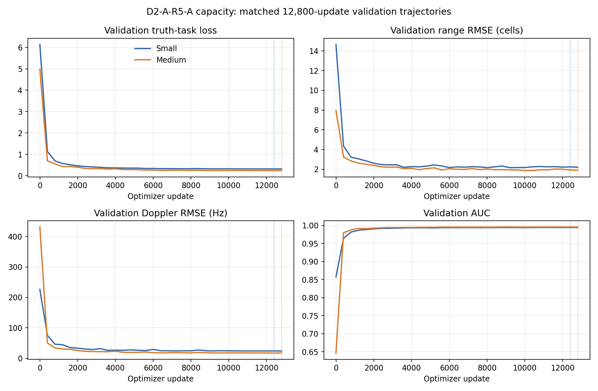

# D2-A-R5-A 容量对照分析

**阶段：** Phase 2 / Small–Medium width-only pilot
**评估代码提交：** `1678a468d5c150ff734d80ad40cf75407a49651f`
**总纲：** `docs/RESEARCH_CHARTER.md` v1.3；本阶段未修改研究总纲。
**训练方式：** E1 物理真值监督；未使用教师损失、蒸馏或 final blind。

## 研究问题与范围

本对照检验在 R5-A 已用训练预算内，增大原始复 IQ TaskStudent 主干宽度能否提高任务性能。Small 是已完成 R5-A S0：width=32、13,383 参数；Medium 是 width=96、82,887 参数。只改变主干宽度，Medium 从 seed 101 初始化。两者沿用相同冻结 E003 train/validation IDs、相同 R5 pair plan、seed 101、E1 loss、AdamW、FP32、有效 batch 64 和 12,800 updates。Medium 顺序使用 CUDA，未同时驻留两个模型。

训练、校准、verification、development 与物理诊断均来自 E003/R5 已使用材料。development 用于筛选和阶段门，不是新 blind；本阶段不估计训练 seed 不确定性。

## 工程与训练

Medium 的 G1 小样本过拟合检查通过：在 16 个配对 scene 上运行 200 updates，truth-task loss 从 `4.1465` 降至 `0.00238`，presence/range-cell 准确率均为 `1.0`，range 与 Doppler 头梯度均为有限非零值。它只验证路径可学习，不代表泛化能力。

| 模型 | 参数 | 更新 / 有效 batch | microbatch | 最佳 update | 最佳 validation task loss | 训练时间 | CUDA 峰值分配显存 |
|---|---:|---:|---:|---:|---:|---:|---:|
| Small | 13,383 | 12,800 / 64 | 16 | 12,400 | 0.32059 | 旧记录未保存累计值 | 274,465,280 bytes |
| Medium | 82,887 | 12,800 / 64 | 16 | 12,800 | 0.24346 | 3,951.3 s（约65.9 min） | 820,737,024 bytes |

Medium 训练期间未触发 OOM，未降低 microbatch，未启用 AMP 或 CPU fallback。它的峰值 CUDA reserved 为 897,581,056 bytes。Small 的旧训练记录没有累计时间，故不能从该记录比较两模型完整训练用时。设备预检记录 AISAR / PyTorch `2.8.0+cu128` / RTX 3050 Laptop `cuda:0`；CUDA 总显存约 4 GiB。

## 主要开发集结果

两个模型各用自己的 H0 calibration 阈值，目标 Pfa=0.05、分位数 `higher`、判定 `score >= threshold`。固定阈值下，常规 H0 verification 接近校准目标；专门的 C3 H0 verification 则两者都未过 0.10 点限。

| 指标 | Small | Medium |
|---|---:|---:|
| H0 calibration Pfa | 0.05005 | 0.05005 |
| H0 verification Pfa（n=8,192） | 0.05017（单侧 exact 95% 上限 0.05432） | 0.04797（上限 0.05204） |
| C3 H0 verification Pfa（n=4,096） | 0.20410（上限 0.21474） | 0.18896（上限 0.19931） |
| Development Pd | 0.96191 | 0.97461 |
| Development AUC | 0.99374 | 0.99583 |
| 全 H1 距离 RMSE（cell） | 2.2393 | 1.8795 |
| 全 H1 Doppler RMSE（Hz） | 25.231 | 17.864 |
| Overall joint success | 0.83887 | 0.91064 |

| 难度 | Small Pd / joint | Small range / Doppler RMSE | Medium Pd / joint | Medium range / Doppler RMSE |
|---|---:|---:|---:|---:|
| C0 | 1.000 / 0.997 | 0.029 cell / 4.735 Hz | 1.000 / 0.999 | 0.015 cell / 2.878 Hz |
| C1 | 1.000 / 0.975 | 0.036 cell / 8.271 Hz | 1.000 / 0.998 | 0.022 cell / 4.602 Hz |
| C2 | 0.988 / 0.852 | 0.176 cell / 16.361 Hz | 1.000 / 0.946 | 0.059 cell / 9.206 Hz |
| C3 | 0.859 / 0.532 | 4.475 cell / 46.776 Hz | 0.898 / 0.699 | 3.758 cell / 34.093 Hz |

配对 base-scene bootstrap 2,000 次，Medium−Small 的 overall Pd 差 `+0.01270`（95% CI `[+0.00854,+0.01685]`），overall joint 差 `+0.07178`（`[+0.06201,+0.08204]`），可辨识 C2/C3 joint 差 `+0.13086`（`[+0.11230,+0.15088]`）。C2/C3 range RMSE 比为 `0.839`（95% CI `[0.731,0.950]`），Doppler RMSE 比为 `0.713`（`[0.654,0.773]`）。预注册的 C2/C3 primary-gain 门（点增益至少 0.02 且 CI 下界大于0）通过。

## 阶段门与解释

- **G1 基础学习：通过。** Medium 的梯度和固定小样本过拟合检查通过；独立开发 AUC、距离和 Doppler 指标优于训练真值常数基线。
- **主要容量增益：通过筛选门。** Medium 在主 C2/C3 joint success 上的增益明显超过冻结最小值，且 bootstrap 区间远离0；多个参数误差指标也改善。
- **任务保护：未通过。** 其余相对保护分量通过；但 Small 与 Medium 的 C3 H0 Pfa 点估计分别为 `0.2041`、`0.1890`，均高于预注册的每模型 `0.10` 上限。两者差值为 `−0.01514`（95% CI `[-0.02979,+0.00122]`），即 Medium 没有证据显示相对 Small 恶化，但两者共同不满足绝对虚警限制。故 Medium 当前不具备候选晋级资格。
- **结论边界：** 宽度增加在本 seed、已使用开发分布和冻结预算内改善了任务估计与 joint success，支持 H-CAP-002 的有限部分；但不能声称已找到可用的更大模型、达到收敛或跨 seed 稳定。宽度增加没有解决 C3 固定阈值迁移，不能据此运行 Large。

H-CAP-001 仍只在 seed 101 和冻结 ID 的 R5-A 训练曲线范围内获支持。H-CAP-002 更新为 **LIMITED SUPPORT / G3 不通过**：width=96 有显著开发任务收益，但绝对 C3 Pfa 保护失败。它不能作为正式非劣效或 blind 结论。

## 科研判断与下一步

本阶段判为 **REFINE**。结果说明单看 joint success 或误差会遗漏实用性约束：Medium 的 C2/C3 参数估计更准，但同一组 C3 H0 上仍有约五分之一触发。该虚警失稳在 Small、Medium、E003 S0/S2、E002 学生以及既有 R3/T001 证据中反复出现，值得作为跨阶段共同的阈值/场景 nuisance 问题记录；本阶段没有额外调阈值或再次搜索检测分数。

不运行 Large、KD 或 final blind。后续唯一优先任务是 R5-B：按项目总纲进行非 CNN 学生架构调研，冻结一个保留三通道原始复 IQ、轻量时频注意力候选，与 Small/Medium CNN 的可比结果建立匹配训练预算和任务门。容量对照显示 Medium 在 C2/C3 上有值得检验的基准增益，但不应把其失败的 C3 Pfa 状态视为已解决；attention pilot 必须继续报告每个模型的 C3 H0 false-alarm guard。

## 文件与复现

- 冻结设计：[`../protocol.md`](../protocol.md)、[`config.yaml`](config.yaml)。
- 训练/环境：[`preflight.json`](preflight.json)、[`g1_overfit_sanity.json`](g1_overfit_sanity.json)、[`training.json`](training.json)；Small history 仍在 R5-A 根目录，Medium history 在 `runs/seed_101/Medium/training_history.csv`。
- 评价：[`metrics.json`](metrics.json)、[`result.csv`](result.csv)、[`roc.csv`](roc.csv)、[`scene_predictions.csv`](scene_predictions.csv)、[`predictions.npz`](predictions.npz)。
- 绘图复现：`AISAR/bin/python scripts/plot_d2a_r5_capacity.py`。
- 训练复现：`AISAR/bin/python scripts/run_d2a_r5_capacity.py --phase preflight|overfit|train|evaluate`；仅在代码/config 已推到 `main` 且 R5-A 前置材料满足时执行。
