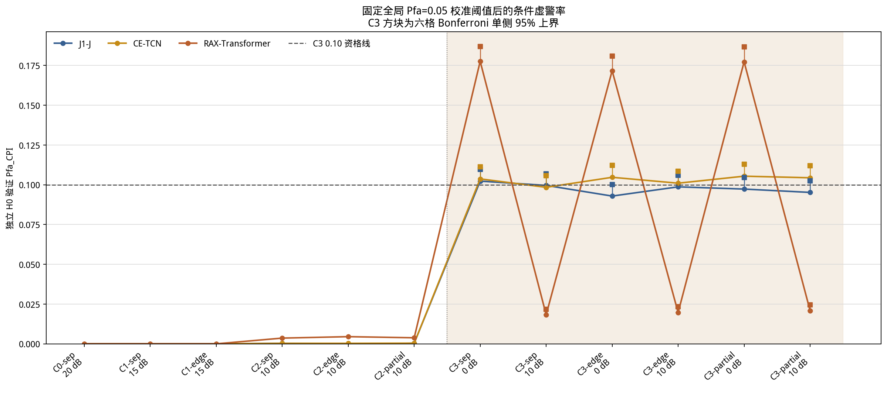
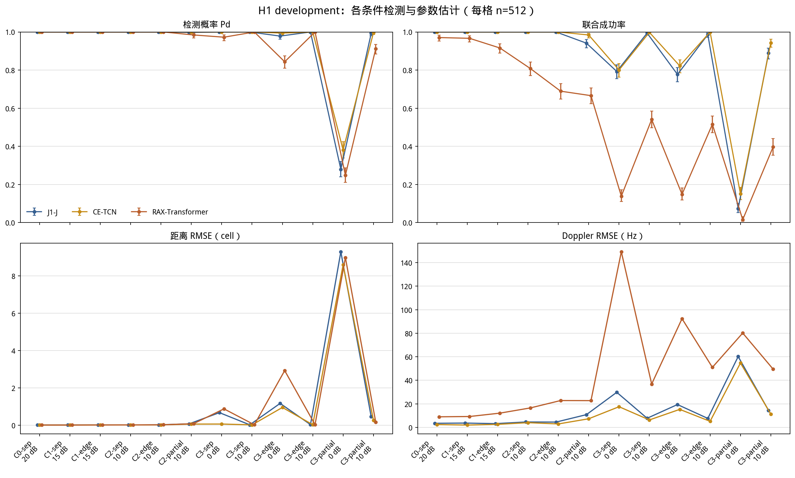
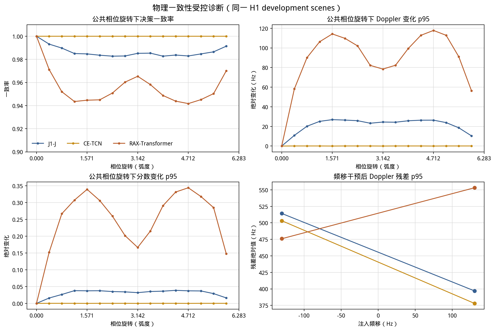

# D2-A-R6-E 阶段分析

**结果状态：** development evaluation complete
**冻结结果提交：** `2eaf7838c07f0b2b9292343fa9ef56f19260db01`
**协议/配置：** protocol v1.0；哈希见 `metrics.json`
**盲测：** 未生成。以下均为单训练 seed 的独立开发评价。

## 1. 研究问题与范围

R6-E按相同场景、真值监督、训练预算和任务损失，比较普通任务级卷积基线J1-J、显式公共相位等变复数CE-TCN、以及保留完整时间—距离网格的RAX-Transformer。它服务研究总纲Q3、Q4、Q6和Q10，判断明确的相位结构与完整轴向序列交互是否提供有用的GMTI检测/参数估计信号，并为后续混合链和教师协作选取有证据的候选。

所有模型都是从原始三通道IQ学习的模型，没有固定FFT/物理频谱前端，也没有教师输入或蒸馏。CE-TCN的物理贡献是无复偏置复数卷积、模长归一化、径向激活和模长任务读出所带来的公共相位等变/不变结构；卷积核仍是可学习的。RAX是完全可学习的实值嵌入与两轴注意力模型，使用相对时间/距离偏置，不保证相位不变或Doppler频移等变。J1-J是无固定物理前端的实值卷积任务基线。

## 2. 执行与公平性

- G0通过：正式split间、与22份历史ID清单间无scene ID重叠；训练、验证、H0校准、H0验证和H1开发数分别为51,200、5,000、120,000、120,000和6,144。未生成final blind。
- G1通过：三模型有限输出/梯度和16对场景200步学习检查均通过；CE-TCN公共相位结构测试通过。
- 三臂均以seed606在RTX 3050 Laptop `cuda:0`、FP32、有效batch64、同一scene顺序和51,200 updates完成。每个模型训练集为51,200个配对场景，每个H0/H1类别各暴露1,638,400 CPI slots，即每场景平均访问32次。
- CE-TCN在正式训练microbatch 8时于update16,800遇到CUDA OOM，按冻结协议从该checkpoint保留优化器和采样器状态，降至microbatch4继续；有效batch仍为64，updates和训练暴露未改变。没有CPU回退。
- 每400 updates记录训练/验证history，每800 updates保存恢复checkpoint。按各臂验证任务损失选择checkpoint：J1-J为14,400，CE-TCN为27,600，RAX为38,400。
- 参数量为J1-J 70,277、CE-TCN 63,429、RAX 60,085，均在预注册的±20%范围。总训练耗时分别约3.71、32.72和10.01小时；正式运行峰值显存allocated约0.41、1.24和0.28 GB。计时是单臂训练时间，不是推理/完整系统延迟。

## 3. 主要任务结果

主指标是6,144个H1开发场景中可辨识C2+C3子集的joint success；两个候选比较采用预注册97.5%配对bootstrap区间。

| 模型 | 全部H1 Pd / joint | C2+C3 Pd / joint | 全H1距离RMSE | 全H1 Doppler RMSE | C3 H0 pooled Pfa（单侧95%上界） | C3六格门 |
|---|---:|---:|---:|---:|---:|---|
| J1-J | 0.9373 / 0.8713 | 0.9164 / 0.8283 | 2.716 cells | 21.24 Hz | 0.09767（0.09968） | 未通过 |
| CE-TCN | 0.9476 / 0.8916 | 0.9301 / 0.8555 | 2.499 cells | 17.86 Hz | 0.10293（0.10500） | 未通过 |
| RAX-Transformer | 0.9134 / 0.5645 | 0.8845 / 0.4355 | 2.742 cells | 61.44 Hz | 0.09758（0.09960） | 未通过 |

CE-TCN相对J1-J的C2+C3 joint差为 **+0.02713**，97.5% CI `[+0.01736,+0.03668]`。它通过预注册的点差至少+0.02且区间下界大于0的候选筛选门。配对任务保护也通过：Pd差`+0.01025`（CI `[+0.00586,+0.01481]`），距离RMSE比`0.9201`（CI `[0.8419,1.0054]`），Doppler RMSE比`0.8408`（CI `[0.7368,0.9290]`）。这是支持CE-TCN继续作为候选的开发证据，不是跨训练seed确认。

RAX-Transformer相对J1-J的C2+C3 joint差为 **−0.39280**（97.5% CI `[-0.40929,-0.37435]`）。Pd差`−0.02393`及其区间下界`−0.03092`越过`−0.02`保护线；距离RMSE ratio区间上界为1.1081，Doppler RMSE ratio为2.8927（CI `[2.5457,3.2514]`）。当前RAX候选明显不适合晋级；此结果只否定本协议的RAX配置，不否定所有Transformer/序列模型。

## 4. 固定阈值与困难条件

三臂各自只用H0 calibration设全局Pfa=0.05阈值，然后在独立120,000个H0验证场景评价。总体Pfa分别为J1-J `0.04889`（单侧95%上界`0.04993`）、CE-TCN `0.05155`（`0.05261`）、RAX `0.04978`（`0.05083`）。但三个模型均未通过C3六格Bonferroni familywise上界全部不超过0.10的绝对保护门。

J1-J与CE-TCN六个C3格的经验Pfa大约分别在`0.0929–0.1023`与`0.0984–0.1054`之间，结果较RAX均衡，但置信上界仍未满足冻结的每格门。RAX出现明显的条件差异：C3的三个0 dB格Pfa为`0.1717–0.1776`，三个10 dB格只有`0.0183–0.0209`；总体或pooled数值因此掩盖了逐条件失配。这里观察到的是条件分数/阈值迁移现象；本实验没有单独识别造成差异的生成因素。

最困难的C3 / partial-overlap / SNR=0 dB / CNR=20 dB格（n=512）仍然很难：

| 模型 | Pd | joint success | AUC | 全H1距离RMSE | 全H1 Doppler RMSE |
|---|---:|---:|---:|---:|---:|
| J1-J | 0.2793 | 0.0742 | 0.6144 | 9.30 cells | 60.22 Hz |
| CE-TCN | 0.3809 | 0.1504 | 0.6987 | 8.60 cells | 54.71 Hz |
| RAX-Transformer | 0.2480 | 0.0156 | 0.5495 | 8.99 cells | 80.19 Hz |

CE-TCN在该格有相对改善，但仍无法称为可靠检测器；其AUC不足0.70，绝对C3 Pfa门也失败。该格结果反驳了“总体较好指标即可证明困难场景可靠”的解释。

## 5. 训练与物理一致性

所有臂的训练损失在51,200步末仍低于早期值，但验证曲线不同：J1-J在14,400步取得最低验证损失0.2245，末步升至0.4032；CE-TCN在27,600步达到0.18236，末步为0.18614；RAX在38,400步达到0.31850，末步为0.32909。J1-J的训练—验证差距扩大最明显；RAX也出现验证回升。不能把这轮51,200称作任何架构的学习上限。CE-TCN的验证曲线后段相对平缓，但仍不代表已经收敛。

在16个公共相位旋转上，CE-TCN决策一致率全部为1.0；最大分数变化p95为`2.11×10⁻⁴`，距离输出变化p95为`3.85×10⁻⁴` cell，Doppler变化p95为0.0864 Hz。这与其结构设计相符，是明确的物理归纳偏置实现证据；单靠这项性质不能说明学生更会估频。

相对地，J1-J的最差相位决策一致率为0.9827，RAX为0.9417。三臂在`±130 Hz`频移干预下的Doppler残差p95都很大：J1-J约514/397 Hz、CE-TCN约503/378 Hz、RAX约476/553 Hz。该受控输入干预没有证明任一网络具有频移等变性。CE-TCN的公共相位性质不能替代频率平移响应。

## 6. 对预注册问题的回答

1. **哪种被测模型最能学习当前频率/任务信息？** CE-TCN在本次单seed development screen中整体最好：C2+C3 joint、Pd及range/Doppler RMSE均优于J1-J，并通过预注册相对门。RAX明显落后。此结论只适用于这三个具体实现和预算。
2. **显式物理归纳偏置是否优于普通序列学习？** CE-TCN的公共相位等变/不变被实现并测到，且相对任务筛选通过；但RAX和J1并非只差一个结构因子，也没有多seed，因此不能把全部增益因果归给相位偏置。它提供了初步支持，不是普遍架构结论。
3. **FFT/固定频谱前端贡献是多少？** 本阶段三个模型均无固定FFT前端；没有对FFT辅助网络做比较。因此不能由R6-E估计传统频谱前端的贡献。
4. **学生能否超过传统方法？** 本阶段没有传统检测/估计器对照；能说明的是CE-TCN优于同批J1-J学生基线，不能说已超过传统算法或达到低虚警要求。
5. **蒸馏是否带来增益？** 未进行蒸馏，结果不支持任何KD收益结论。它为下一轮teacher pilot提供了一个较强且物理相位行为明确的学生候选。
6. **对后续三通道相位估计的启示？** 显式保留复数相位对公共旋转结构有价值，但必须分别验证任务误差、频移响应和C3固定阈值稳定性；结构不变性本身不是完整的相干信息学习证据。

## 7. 阶段结论与路线

**阶段结论：REFINE。** 将CE-TCN作为R6-F混合链中优先进入新冻结协议的NN候选，同时保留J1-J作为匹配学生参考；不将CE-TCN称为合格低虚警检测器。当前RAX-Transformer候选停止扩展，不外推至整个Transformer家族。R6-E不触发多seed追加训练、蒸馏权重搜索或final blind。

接下来按已批准路线进入R6-F，先冻结并测试传统/NN混合链的端到端比较协议。R6-G再从R5-C教师质量与教学负结果、R6-F完整链结果及本阶段学生表现中，选择至多一种教师知识形式开展truth-only、teacher-assisted和必要truth-assisted matched对照。知识教师错误必须按独立场景分层报告；不得让蒸馏掩盖学生基础任务学习失败。正式多seed及盲测继续受R6-P7条件约束。

R6-E训练/验证IQ缓存按R6-E owner清单清理；保留协议、配置、split清单、G0/G1审计、训练记录/曲线、checkpoint、逐scene预测、指标、图和本报告。研究总纲及旧冻结结果未修改。
