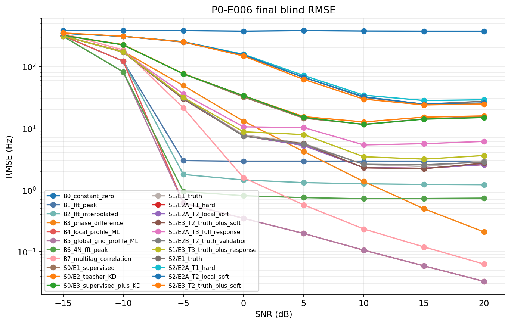
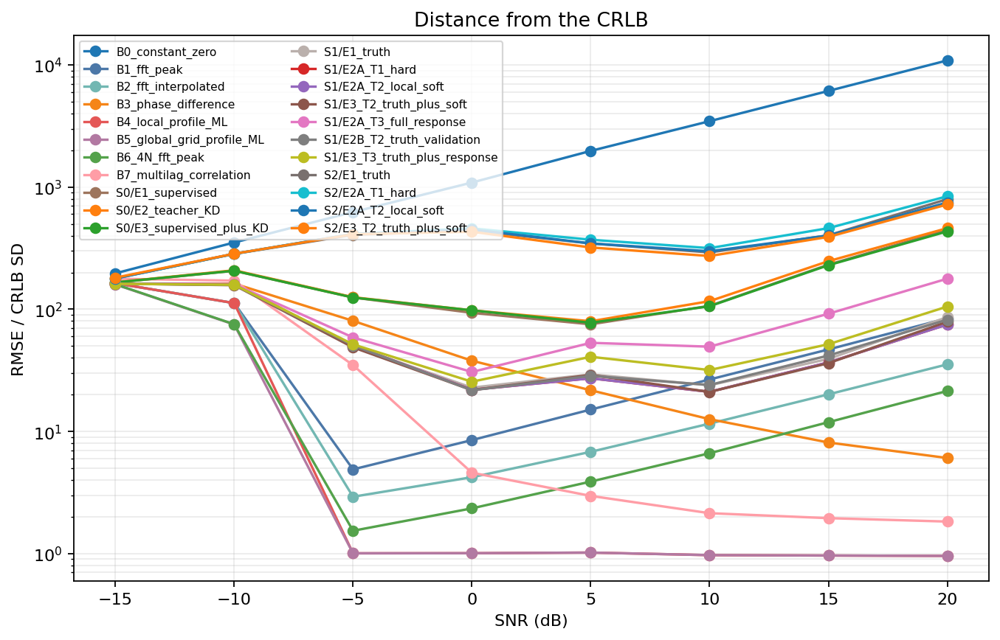
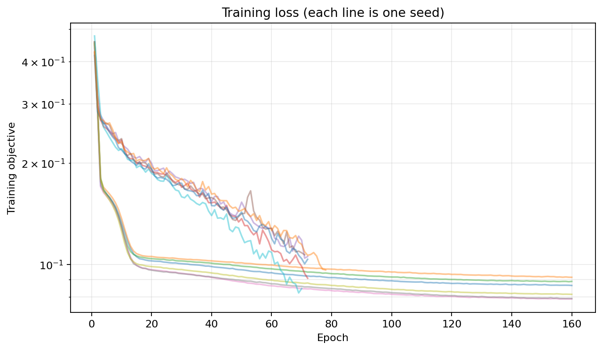
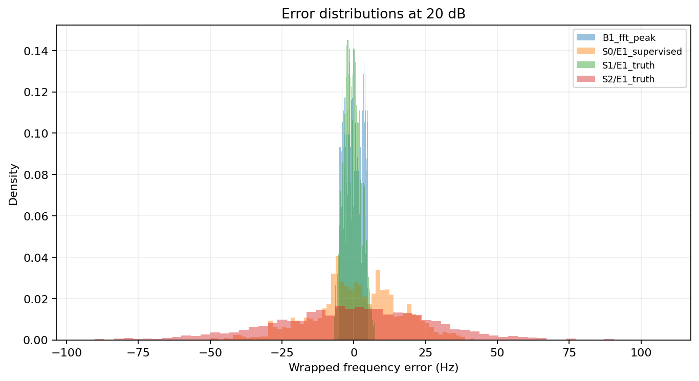
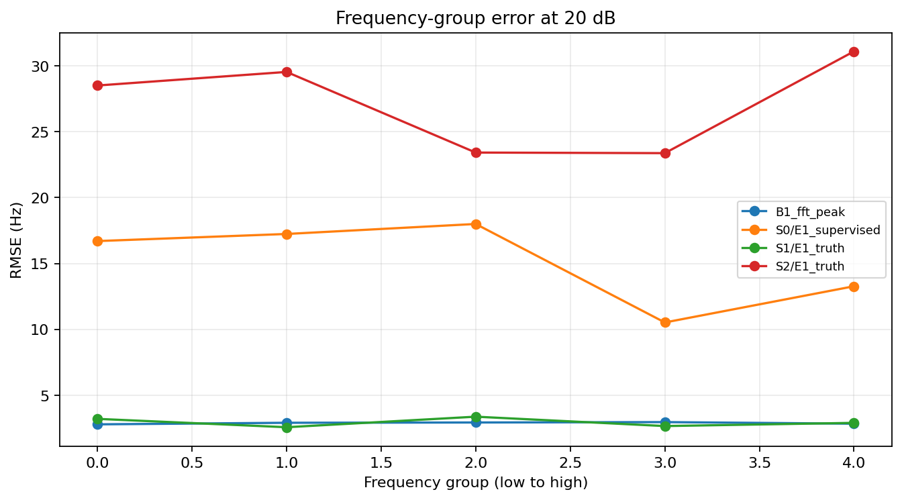
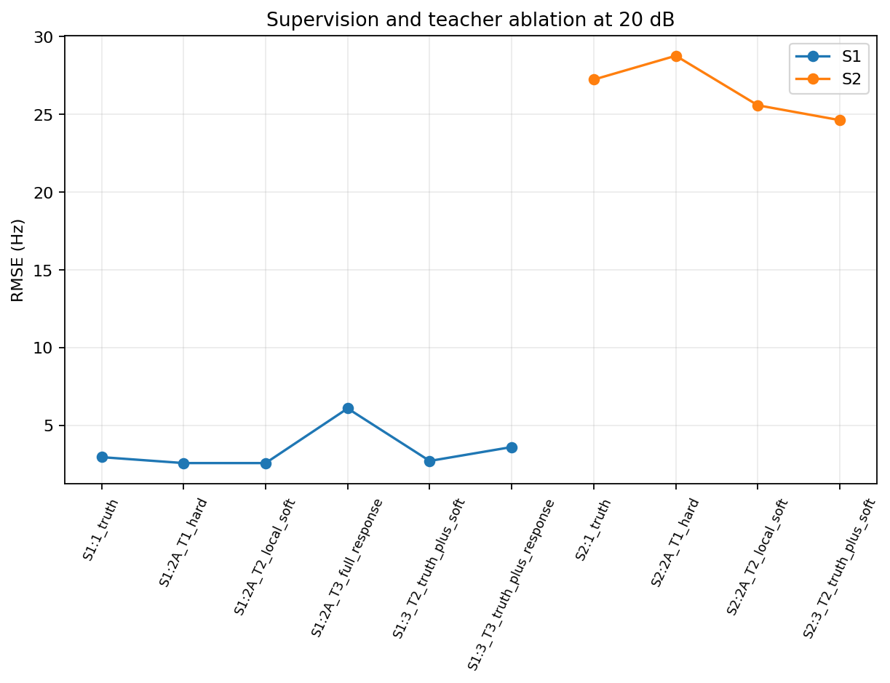

# P0-E006 分析

## 条件与盲测

AISAR 中 PyTorch CUDA 训练；PRF=1300.0 Hz，N=130，独立训练种子 [1101, 1202, 1303]。E001–E005 的 seed 7070 数据仅作为开发基准；本报告最终结果使用协议冻结后生成的 final seed 919191，每个 SNR 1024 例。全为复单音 AWGN 仿真。

S0 是冻结的 E005 CNN。S1 是 lags=[1, 2, 4, 8] 的归一化复相关 MLP，并对比同样复相关的非学习相干评分。S2 输入固定 520 点 FFT 对数功率，是频率响应引导混合模型。完整 local profile 目标只在预注册指定的 S1 对照中使用。

## 20 dB 代表性 RMSE

| Method | RMSE (Hz) |
|---|---:|
| B1_fft_peak | 2.8839 |
| B2_fft_interpolated | 1.21013 |
| B3_phase_difference | 0.207243 |
| B4_local_profile_ML | 0.0327382 |
| B5_global_grid_profile_ML | 0.0327381 |
| B6_4N_fft_peak | 0.733245 |
| B7_multilag_correlation | 0.0625386 |
| S0/E1_supervised | 15.2733 |
| S1/E1_truth | 2.94729 |
| S2/E1_truth | 27.2382 |

## E1 对 FFT 峰值的配对比较

负差值支持学生；区间跨零表示证据不充分。

| Student | SNR (dB) | E1 − FFT RMSE (Hz) | paired 95% CI (Hz) |
|---|---:|---:|---:|
| S1/E1_truth | 0.0 | 4.927 | [4.203, 5.783] |
| S1/E1_truth | 5.0 | 2.736 | [2.473, 3.025] |
| S1/E1_truth | 10.0 | -0.2731 | [-0.7591, 0.05343] |
| S1/E1_truth | 15.0 | -0.4601 | [-0.6553, -0.2901] |
| S1/E1_truth | 20.0 | 0.06971 | [-0.1903, 0.3118] |
| S2/E1_truth | 0.0 | 148.1 | [137.3, 158.4] |
| S2/E1_truth | 5.0 | 63.58 | [57.81, 69.82] |
| S2/E1_truth | 10.0 | 28.79 | [25.46, 31.44] |
| S2/E1_truth | 15.0 | 21.99 | [16.56, 26.3] |
| S2/E1_truth | 20.0 | 24.55 | [20.63, 27.68] |

## 蒸馏比较

| E3 method | SNR (dB) | E3 − E1 RMSE (Hz) | paired 95% CI (Hz) |
|---|---:|---:|---:|
| S1/E3_T2_truth_plus_soft | 0.0 | -0.3691 | [-0.7339, -0.06374] |
| S1/E3_T2_truth_plus_soft | 5.0 | -0.06161 | [-0.2026, 0.07831] |
| S1/E3_T2_truth_plus_soft | 10.0 | -0.3161 | [-0.8284, 0.05121] |
| S1/E3_T2_truth_plus_soft | 15.0 | -0.1783 | [-0.4065, 0.03969] |
| S1/E3_T2_truth_plus_soft | 20.0 | -0.2289 | [-0.4168, -0.02782] |
| S1/E3_T3_truth_plus_response | 0.0 | 0.9484 | [0.1276, 1.837] |
| S1/E3_T3_truth_plus_response | 5.0 | 2.297 | [1.121, 3.941] |
| S1/E3_T3_truth_plus_response | 10.0 | 0.841 | [0.4493, 1.336] |
| S1/E3_T3_truth_plus_response | 15.0 | 0.7591 | [0.4359, 1.023] |
| S1/E3_T3_truth_plus_response | 20.0 | 0.6471 | [0.437, 0.8906] |
| S2/E3_T2_truth_plus_soft | 0.0 | -3.396 | [-12.05, 3.62] |
| S2/E3_T2_truth_plus_soft | 5.0 | -4.799 | [-9.374, 0.1577] |
| S2/E3_T2_truth_plus_soft | 10.0 | -2.102 | [-4.188, -0.171] |
| S2/E3_T2_truth_plus_soft | 15.0 | -0.9582 | [-4.776, 2.355] |
| S2/E3_T2_truth_plus_soft | 20.0 | -2.745 | [-6.263, 0.08573] |

## E2 教师目标及验证协议对照

| E2 method (minus matched reference) | SNR (dB) | ΔRMSE (Hz) | paired 95% CI (Hz) |
|---|---:|---:|---:|
| S1/E2A_T1_hard | 0.0 | -0.3278 | [-0.8727, 0.1486] |
| S1/E2A_T1_hard | 5.0 | -0.4011 | [-0.713, -0.1131] |
| S1/E2A_T1_hard | 10.0 | -0.3149 | [-0.7395, 0.217] |
| S1/E2A_T1_hard | 15.0 | -0.1398 | [-0.3358, 0.08332] |
| S1/E2A_T1_hard | 20.0 | -0.3793 | [-0.6242, -0.1293] |
| S1/E2A_T2_local_soft | 0.0 | -0.3336 | [-0.8347, 0.1368] |
| S1/E2A_T2_local_soft | 5.0 | -0.4053 | [-0.7156, -0.1038] |
| S1/E2A_T2_local_soft | 10.0 | -0.3132 | [-0.7168, 0.1468] |
| S1/E2A_T2_local_soft | 15.0 | -0.1396 | [-0.3338, 0.08018] |
| S1/E2A_T2_local_soft | 20.0 | -0.3798 | [-0.635, -0.1233] |
| S1/E2A_T3_full_response | 0.0 | 2.676 | [2.131, 3.303] |
| S1/E2A_T3_full_response | 5.0 | 4.577 | [4.017, 5.195] |
| S1/E2A_T3_full_response | 10.0 | 2.786 | [1.499, 3.547] |
| S1/E2A_T3_full_response | 15.0 | 3.298 | [1.695, 4.367] |
| S1/E2A_T3_full_response | 20.0 | 3.235 | [1.568, 4.141] |
| S1/E2B_T2_truth_validation | 0.0 | -0.4005 | [-0.9974, 0.1377] |
| S1/E2B_T2_truth_validation | 5.0 | -0.1566 | [-0.3941, 0.06246] |
| S1/E2B_T2_truth_validation | 10.0 | -0.004983 | [-0.3551, 0.3484] |
| S1/E2B_T2_truth_validation | 15.0 | 0.1526 | [-0.05305, 0.3903] |
| S1/E2B_T2_truth_validation | 20.0 | -0.145 | [-0.4208, 0.1304] |
| S2/E2A_T1_hard | 0.0 | 6.11 | [0.2202, 12.68] |
| S2/E2A_T1_hard | 5.0 | 4.846 | [0.1816, 9.479] |
| S2/E2A_T1_hard | 10.0 | 2.567 | [-0.445, 5.895] |
| S2/E2A_T1_hard | 15.0 | 3.264 | [-1.209, 10.48] |
| S2/E2A_T1_hard | 20.0 | 1.348 | [-2.795, 6.004] |
| S2/E2A_T2_local_soft | 0.0 | 2.95 | [-4.001, 10.45] |
| S2/E2A_T2_local_soft | 5.0 | 0.07878 | [-5.475, 5.03] |
| S2/E2A_T2_local_soft | 10.0 | 0.5752 | [-2.717, 4.735] |
| S2/E2A_T2_local_soft | 15.0 | -0.4237 | [-4.918, 4.47] |
| S2/E2A_T2_local_soft | 20.0 | -1.728 | [-3.922, 0.3181] |

| Teacher/validation contrast | SNR (dB) | ΔRMSE (Hz) | paired 95% CI (Hz) |
|---|---:|---:|---:|
| S1/E2A_soft_minus_E2B_soft | 0.0 | 0.06686 | [-0.08851, 0.2102] |
| S1/E2A_soft_minus_E2B_soft | 5.0 | -0.2486 | [-0.5522, 0.02102] |
| S1/E2A_soft_minus_E2B_soft | 10.0 | -0.3082 | [-0.79, 0.00301] |
| S1/E2A_soft_minus_E2B_soft | 15.0 | -0.2922 | [-0.6286, -0.01455] |
| S1/E2A_soft_minus_E2B_soft | 20.0 | -0.2348 | [-0.5112, -0.01492] |
| S1/T3_full_response_minus_T1_point | 0.0 | 3.004 | [2.336, 3.658] |
| S1/T3_full_response_minus_T1_point | 5.0 | 4.978 | [4.5, 5.459] |
| S1/T3_full_response_minus_T1_point | 10.0 | 3.101 | [1.947, 4.006] |
| S1/T3_full_response_minus_T1_point | 15.0 | 3.437 | [1.693, 4.589] |
| S1/T3_full_response_minus_T1_point | 20.0 | 3.614 | [1.659, 4.602] |
| S1/T2_local_soft_minus_T1_point | 0.0 | -0.005798 | [-0.01809, 0.00272] |
| S1/T2_local_soft_minus_T1_point | 5.0 | -0.004226 | [-0.01125, 0.001072] |
| S1/T2_local_soft_minus_T1_point | 10.0 | 0.001782 | [-0.001357, 0.004276] |
| S1/T2_local_soft_minus_T1_point | 15.0 | 0.000136 | [-0.004853, 0.005997] |
| S1/T2_local_soft_minus_T1_point | 20.0 | -0.0004622 | [-0.00598, 0.00585] |

## 独立阶段门

- **G1 learning feasibility:** **未通过**；无噪声与 20 dB 标准见 `metrics.json`。
- **G2 classical competitiveness:** **未通过**；须同时超过 FFT 主门和同一物理前端基线。
- **G3 distillation value:** **未通过**；要求配对 95% 区间低于零、相邻主 SNR 两点通过，且每点至少 2/3 个训练种子的 RMSE 方向改善。

## 物理变换与分组

`physics_diagnostics.json` 报告公共相位、整体复幅度缩放、频率平移和复共轭下学生输出的实测偏差。对特征的解析不变性不自动等于网络严格等变。`result.csv` 含 SNR、频率、初相、幅度和 FFT 栅格偏移分组。

## 图表

## 限制

这些结果只适用于单目标复正弦 + 圆对称复 AWGN 仿真。S2 显式使用 FFT 物理前端；其性能不能解释为纯原始 IQ 端到端优势。局部教师似然只覆盖教师峰周围 ±2 个原生 FFT bin，不是全局后验。任何结果均不证明杂波检测、多目标能力、真实数据泛化、目标角度/速度估计或部署加速。
