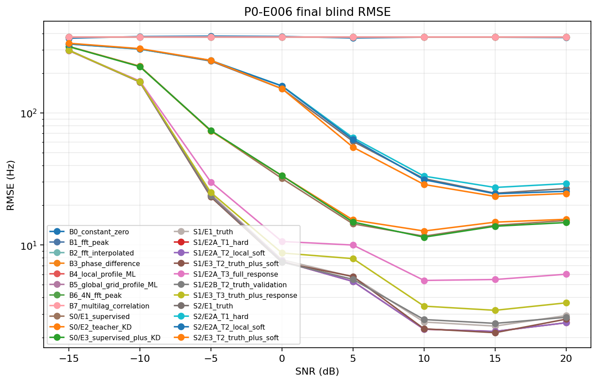
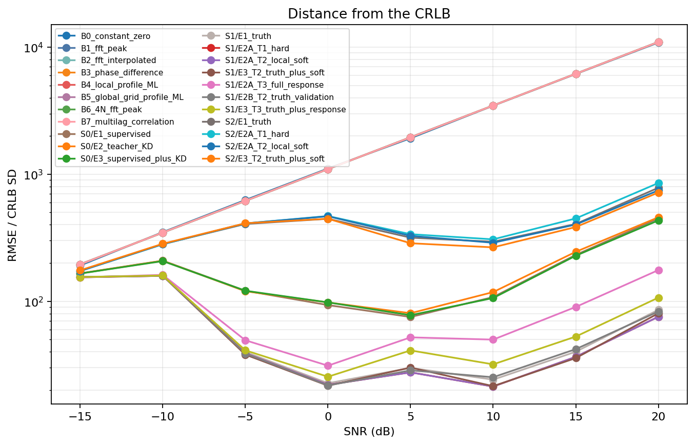
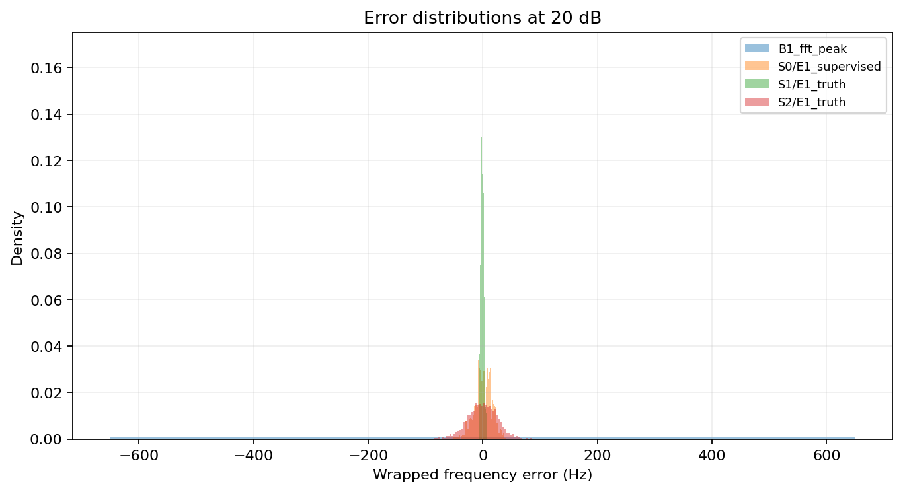
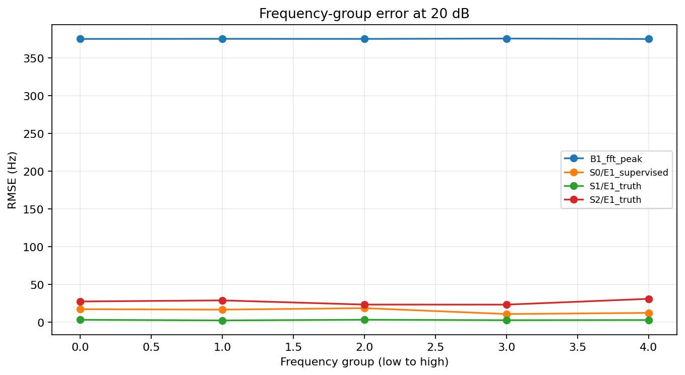
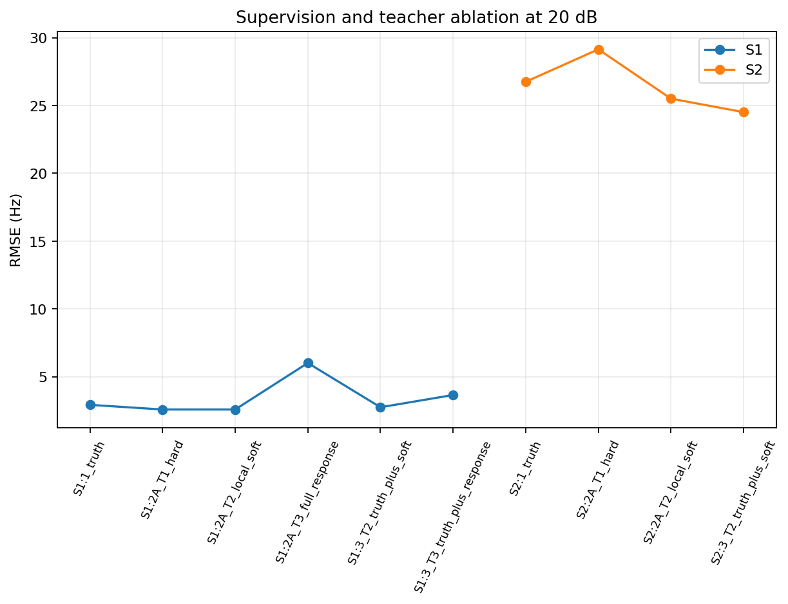

# P0-E006 分析

## 条件与盲测

AISAR 中 PyTorch CUDA 训练；PRF=1300.0 Hz，N=130，独立训练种子 [1101, 1202, 1303]。E001–E005 的 seed 7070 数据仅作为开发基准；本报告最终结果使用协议冻结后生成的 final seed 909090，每个 SNR 1024 例。全为复单音 AWGN 仿真。

S0 是冻结的 E005 CNN。S1 是 lags=[1, 2, 4, 8] 的归一化复相关 MLP，并对比同样复相关的非学习相干评分。S2 输入固定 520 点 FFT 对数功率，是频率响应引导混合模型。完整 local profile 目标只在预注册指定的 S1 对照中使用。

## 20 dB 代表性 RMSE

| Method | RMSE (Hz) |
|---|---:|
| B1_fft_peak | 375.278 |
| B2_fft_interpolated | 375.279 |
| B3_phase_difference | 375.274 |
| B4_local_profile_ML | 375.279 |
| B5_global_grid_profile_ML | 375.286 |
| B6_4N_fft_peak | 375.289 |
| B7_multilag_correlation | 375.275 |
| S0/E1_supervised | 15.3302 |
| S1/E1_truth | 2.9263 |
| S2/E1_truth | 26.7497 |

## E1 对 FFT 峰值的配对比较

负差值支持学生；区间跨零表示证据不充分。

| Student | SNR (dB) | E1 − FFT RMSE (Hz) | paired 95% CI (Hz) |
|---|---:|---:|---:|
| S1/E1_truth | 0.0 | -361.9 | [-371.9, -351.5] |
| S1/E1_truth | 5.0 | -375.6 | [-385.7, -365.7] |
| S1/E1_truth | 10.0 | -372 | [-382.6, -361.8] |
| S1/E1_truth | 15.0 | -374 | [-384, -363.4] |
| S1/E1_truth | 20.0 | -373.3 | [-383.2, -363.3] |
| S2/E1_truth | 0.0 | -217.3 | [-230.9, -203.1] |
| S2/E1_truth | 5.0 | -320.5 | [-331.7, -309.7] |
| S2/E1_truth | 10.0 | -342.8 | [-353, -332.8] |
| S2/E1_truth | 15.0 | -351.5 | [-362.4, -340.3] |
| S2/E1_truth | 20.0 | -349.3 | [-359.9, -338.7] |

## 蒸馏比较

| E3 method | SNR (dB) | E3 − E1 RMSE (Hz) | paired 95% CI (Hz) |
|---|---:|---:|---:|
| S1/E3_T2_truth_plus_soft | 0.0 | -0.3459 | [-0.7596, -0.03124] |
| S1/E3_T2_truth_plus_soft | 5.0 | 0.03693 | [-0.1025, 0.1707] |
| S1/E3_T2_truth_plus_soft | 10.0 | -0.3032 | [-0.86, 0.09509] |
| S1/E3_T2_truth_plus_soft | 15.0 | -0.2548 | [-0.4943, 0.01487] |
| S1/E3_T2_truth_plus_soft | 20.0 | -0.1679 | [-0.3253, -0.01866] |
| S1/E3_T3_truth_plus_response | 0.0 | 1.004 | [0.137, 1.701] |
| S1/E3_T3_truth_plus_response | 5.0 | 2.208 | [1.083, 3.755] |
| S1/E3_T3_truth_plus_response | 10.0 | 0.8206 | [0.4628, 1.24] |
| S1/E3_T3_truth_plus_response | 15.0 | 0.7686 | [0.452, 1.056] |
| S1/E3_T3_truth_plus_response | 20.0 | 0.7209 | [0.4222, 1.087] |
| S2/E3_T2_truth_plus_soft | 0.0 | 0.1739 | [-5.36, 5.812] |
| S2/E3_T2_truth_plus_soft | 5.0 | -5.791 | [-10.63, -0.9591] |
| S2/E3_T2_truth_plus_soft | 10.0 | -3.073 | [-4.438, -1.747] |
| S2/E3_T2_truth_plus_soft | 15.0 | -1.54 | [-4.445, 1.113] |
| S2/E3_T2_truth_plus_soft | 20.0 | -2.351 | [-5.54, 0.23] |

## E2 教师目标及验证协议对照

| E2 method (minus matched reference) | SNR (dB) | ΔRMSE (Hz) | paired 95% CI (Hz) |
|---|---:|---:|---:|
| S1/E2A_T1_hard | 0.0 | -0.2264 | [-0.7291, 0.2351] |
| S1/E2A_T1_hard | 5.0 | -0.4414 | [-0.8199, -0.07049] |
| S1/E2A_T1_hard | 10.0 | -0.3156 | [-0.7181, 0.2862] |
| S1/E2A_T1_hard | 15.0 | -0.2017 | [-0.3934, 0.01319] |
| S1/E2A_T1_hard | 20.0 | -0.342 | [-0.5514, -0.08679] |
| S1/E2A_T2_local_soft | 0.0 | -0.2317 | [-0.723, 0.2157] |
| S1/E2A_T2_local_soft | 5.0 | -0.444 | [-0.8134, -0.08991] |
| S1/E2A_T2_local_soft | 10.0 | -0.3145 | [-0.7174, 0.2141] |
| S1/E2A_T2_local_soft | 15.0 | -0.2008 | [-0.3978, 0.02266] |
| S1/E2A_T2_local_soft | 20.0 | -0.3425 | [-0.5637, -0.09042] |
| S1/E2A_T3_full_response | 0.0 | 2.917 | [2.315, 3.535] |
| S1/E2A_T3_full_response | 5.0 | 4.254 | [3.739, 4.827] |
| S1/E2A_T3_full_response | 10.0 | 2.801 | [1.563, 3.533] |
| S1/E2A_T3_full_response | 15.0 | 3.132 | [1.56, 3.987] |
| S1/E2A_T3_full_response | 20.0 | 3.165 | [1.69, 4.134] |
| S1/E2B_T2_truth_validation | 0.0 | -0.3141 | [-0.9133, 0.2328] |
| S1/E2B_T2_truth_validation | 5.0 | -0.2388 | [-0.6511, 0.1497] |
| S1/E2B_T2_truth_validation | 10.0 | 0.09497 | [-0.2446, 0.4816] |
| S1/E2B_T2_truth_validation | 15.0 | 0.1158 | [-0.07805, 0.3477] |
| S1/E2B_T2_truth_validation | 20.0 | -0.09655 | [-0.342, 0.194] |
| S2/E2A_T1_hard | 0.0 | 7.832 | [0.4292, 16.38] |
| S2/E2A_T1_hard | 5.0 | 3.996 | [-0.5048, 8.988] |
| S2/E2A_T1_hard | 10.0 | 1.359 | [-2.372, 4.727] |
| S2/E2A_T1_hard | 15.0 | 2.363 | [-1.335, 7.969] |
| S2/E2A_T1_hard | 20.0 | 2.223 | [-1.681, 6.731] |
| S2/E2A_T2_local_soft | 0.0 | 7.31 | [-1.204, 16.62] |
| S2/E2A_T2_local_soft | 5.0 | 2.055 | [-2.149, 6.338] |
| S2/E2A_T2_local_soft | 10.0 | -0.6024 | [-3.868, 3.386] |
| S2/E2A_T2_local_soft | 15.0 | -0.506 | [-3.796, 3.295] |
| S2/E2A_T2_local_soft | 20.0 | -1.288 | [-3.455, 0.8267] |

| Teacher/validation contrast | SNR (dB) | ΔRMSE (Hz) | paired 95% CI (Hz) |
|---|---:|---:|---:|
| S1/E2A_soft_minus_E2B_soft | 0.0 | 0.08246 | [-0.07449, 0.2316] |
| S1/E2A_soft_minus_E2B_soft | 5.0 | -0.2052 | [-0.5056, 0.05077] |
| S1/E2A_soft_minus_E2B_soft | 10.0 | -0.4095 | [-0.8226, -0.1356] |
| S1/E2A_soft_minus_E2B_soft | 15.0 | -0.3166 | [-0.6511, -0.02681] |
| S1/E2A_soft_minus_E2B_soft | 20.0 | -0.2459 | [-0.577, 0.05056] |
| S1/T3_full_response_minus_T1_point | 0.0 | 3.144 | [2.25, 4.122] |
| S1/T3_full_response_minus_T1_point | 5.0 | 4.696 | [4.042, 5.477] |
| S1/T3_full_response_minus_T1_point | 10.0 | 3.117 | [2.102, 4.068] |
| S1/T3_full_response_minus_T1_point | 15.0 | 3.334 | [1.589, 4.307] |
| S1/T3_full_response_minus_T1_point | 20.0 | 3.507 | [1.76, 4.522] |
| S1/T2_local_soft_minus_T1_point | 0.0 | -0.005319 | [-0.01872, 0.003204] |
| S1/T2_local_soft_minus_T1_point | 5.0 | -0.002667 | [-0.009304, 0.001443] |
| S1/T2_local_soft_minus_T1_point | 10.0 | 0.001101 | [-0.001932, 0.003359] |
| S1/T2_local_soft_minus_T1_point | 15.0 | 0.0009393 | [-0.004381, 0.006606] |
| S1/T2_local_soft_minus_T1_point | 20.0 | -0.0004176 | [-0.006048, 0.006313] |

## 独立阶段门

- **G1 learning feasibility:** **未通过**；无噪声与 20 dB 标准见 `metrics.json`。
- **G2 classical competitiveness:** **通过**；须同时超过 FFT 主门和同一物理前端基线。
- **G3 distillation value:** **通过**；要求配对 95% 区间低于零、相邻主 SNR 两点通过，且每点至少 2/3 个训练种子的 RMSE 方向改善。

## 物理变换与分组

`physics_diagnostics.json` 报告公共相位、整体复幅度缩放、频率平移和复共轭下学生输出的实测偏差。对特征的解析不变性不自动等于网络严格等变。`result.csv` 含 SNR、频率、初相、幅度和 FFT 栅格偏移分组。

## 图表

## 限制

这些结果只适用于单目标复正弦 + 圆对称复 AWGN 仿真。S2 显式使用 FFT 物理前端；其性能不能解释为纯原始 IQ 端到端优势。局部教师似然只覆盖教师峰周围 ±2 个原生 FFT bin，不是全局后验。任何结果均不证明杂波检测、多目标能力、真实数据泛化、目标角度/速度估计或部署加速。
